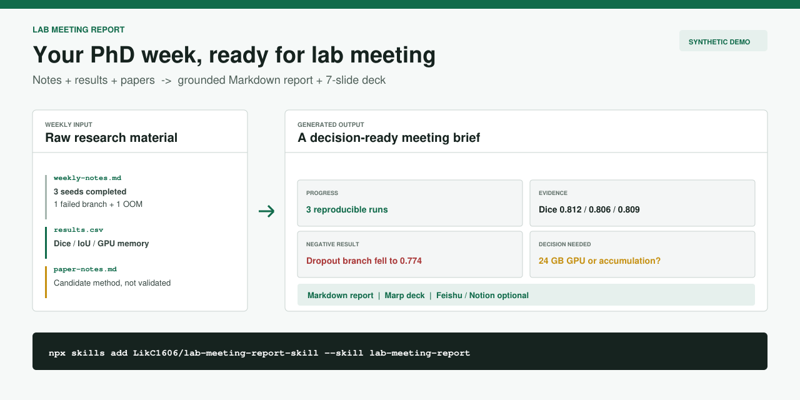

<!-- README_SYNC: source=f6c06b7388accc0eef6d59e10cfdb667e0fe6671; updated=2026-11-18 -->

English · [简体中文](./README.zh-CN.md)

# Lab Meeting Report

Turn a week's research notes, figures, papers, and experiment files into a lab meeting report that keeps the results, failed attempts, and decisions traceable to the material you supplied. The first deliverable is a local Markdown file.

If it saves you time before a meeting, [star the repository](https://github.com/LikC1606/lab-meeting-report-skill/stargazers) to find it again.

[](https://github.com/LikC1606/lab-meeting-report-skill/stargazers)
[](https://github.com/LikC1606/lab-meeting-report-skill/actions/workflows/validate-skill.yml)
[](https://skills.sh/LikC1606/lab-meeting-report-skill)
[](https://github.com/LikC1606/lab-meeting-report-skill/releases)
[](./LICENSE)

## Install and try it

```bash
npx skills add https://github.com/LikC1606/lab-meeting-report-skill --skill lab-meeting-report
```

Ask the agent: “Use $lab-meeting-report to read ./weekly and my pasted update, then prepare this week's lab meeting summary.” Only the source is required. The standard output is a dated file at `reports/group-meeting/YYYY-MM-DD.md`. Its opening covers what changed, the evidence, what is blocked, and what to do next.

For a global, non-interactive install on macOS or Linux:

```bash
npx skills add LikC1606/lab-meeting-report-skill@lab-meeting-report -g -y
```

On Windows PowerShell:

```powershell
npx.cmd skills add LikC1606/lab-meeting-report-skill@lab-meeting-report -g -y
```

If GitHub cloning is unavailable, [download the ZIP](https://github.com/LikC1606/lab-meeting-report-skill/archive/refs/heads/main.zip), extract it, then install from that directory:

```bash
npx skills add ./lab-meeting-report-skill-main --skill lab-meeting-report --copy -y
```

## Try the synthetic demo



The [60-second demo](https://github.com/LikC1606/lab-meeting-report-skill/discussions/1) uses a fictional microscopy-segmentation project. Give the agent its [weekly notes](./examples/weekly-summary/weekly-notes.md), [results CSV](./examples/weekly-summary/results.csv), and [paper notes](./examples/weekly-summary/paper-notes.md), and ask for a report and a 10-minute Marp deck. Compare with the [sample report](./examples/weekly-summary/report.md) and [seven-slide deck](./examples/weekly-summary/slides.md): both preserve the failed branch and the resource decision, without treating the paper's method as a validated result on the demo data.

| Mode | Example |
| --- | --- |
| research progress report | [Experiments, results, and blockers](./examples/research-progress/report.md) |
| journal club | [Paper evidence and limits](./examples/journal-club/report.md) |
| mixed | [Research progress connected to a paper](./examples/mixed/report.md) |

The examples are synthetic. Real inputs can also include results, figures, code changes, and explicitly selected cloud files when the host can read them. With sparse material the skill can return a brief report; use `audit` when you want claim-level provenance. In the `after` or `both` meeting stages it keeps the pre-meeting record and adds explicitly recorded decisions and actions.

## Optional exports

The [Skill](./lab-meeting-report/SKILL.md) builds and validates local Markdown before using an adapter. Feishu/Lark uses [lark-cli](https://github.com/larksuite/cli) and the relevant Lark skills. Notion uses the [Notion MCP](https://developers.notion.com/guides/mcp/overview). Publishing requires a request and a defined destination; the adapter reads the saved page back and records its verified link. A failed export does not invalidate the local report.

[Marp](https://github.com/marp-team/marp-cli) handles quick decks; [Quarto](https://quarto.org/docs/presentations/) supports academic slides and equations. For editable PowerPoint, use an existing tested [PptxGenJS](https://github.com/gitbrent/PptxGenJS) layout adapter. Slidev is an option for projects that already use it or explicitly choose it. When a dependency is missing, keep the Markdown deck and report the missing tool.

## Evidence and evaluation

The workflow retains negative results, conflicting measurements, and manual edits. It separates hypotheses from measured results and keeps units and source boundaries. The [evaluation design](./docs/superpowers/specs/2026-07-13-lab-meeting-report-v1.2-quality-evaluation-design.md), [versioned benchmark](./benchmarks/v1.1-v1.2/benchmark.md), and [claim-level self-audit](./benchmarks/v1.1-v1.2/semantic-review-final.json) document checks on eight [public synthetic progress cases](./evals/research-progress/cases). A separate [mixed weekly case](./evals/weekly-workflow/cases/chinese-mixed-decision) checks report and Marp structure, numeric fidelity, and failure retention. These evaluations do not measure real student preference or cloud publishing reliability.

## 中文说明

[中文文档](./README.zh-CN.md) covers the same installation options and workflow. Use the [Chinese media kit](./docs/MEDIA_KIT.zh-CN.md) to share the labeled synthetic demo.

See [CONTRIBUTING.md](./CONTRIBUTING.md) and [SECURITY.md](./SECURITY.md). Bring a reproducible example to [Issues](https://github.com/LikC1606/lab-meeting-report-skill/issues), or compare workflows in [Discussions](https://github.com/LikC1606/lab-meeting-report-skill/discussions).

Released under the [MIT License](./LICENSE).
