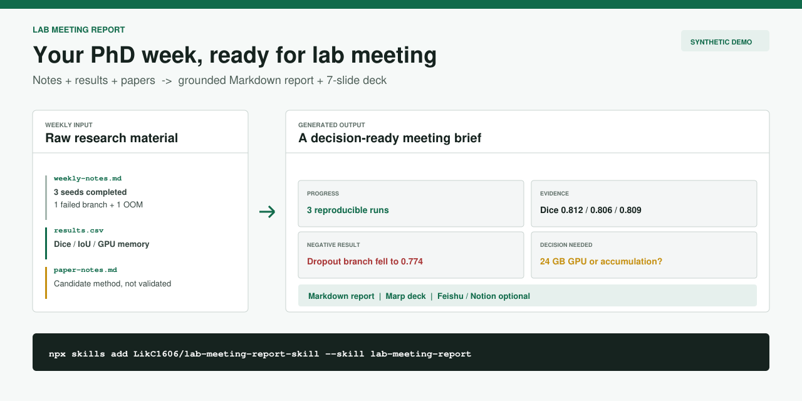

<!-- README_SYNC: source=f6c06b7388accc0eef6d59e10cfdb667e0fe6671; updated=2026-11-18 -->

[English](./README.md) · 简体中文

# Lab Meeting Report · 组会周报

把一周的笔记、论文、图表和实验文件整理成有据可查的组会周报。先交付本地 Markdown，保留关键结果、失败尝试和待讨论的决定。

如果它帮你节省了组会准备时间，可以 [Star 收藏](https://github.com/LikC1606/lab-meeting-report-skill/stargazers)。

[](https://github.com/LikC1606/lab-meeting-report-skill/stargazers)
[](https://github.com/LikC1606/lab-meeting-report-skill/actions/workflows/validate-skill.yml)
[](https://skills.sh/LikC1606/lab-meeting-report-skill)
[](https://github.com/LikC1606/lab-meeting-report-skill/releases)
[](./LICENSE)

## 安装和试用

```bash
npx skills add https://github.com/LikC1606/lab-meeting-report-skill --skill lab-meeting-report
```

安装后可以直接说：「用 $lab-meeting-report 读 ./weekly 和我补充的进展，写一份本周组会总结。」来源是唯一必填项。默认产物是 `reports/group-meeting/YYYY-MM-DD.md`，首屏交代进展、关键证据、阻塞和下一步。

macOS 或 Linux 全局非交互安装：

```bash
npx skills add LikC1606/lab-meeting-report-skill@lab-meeting-report -g -y
```

Windows PowerShell：

```powershell
npx.cmd skills add LikC1606/lab-meeting-report-skill@lab-meeting-report -g -y
```

GitHub 克隆受网络影响时，可先[下载 ZIP](https://github.com/LikC1606/lab-meeting-report-skill/archive/refs/heads/main.zip)，解压后从本地安装：

```bash
npx skills add ./lab-meeting-report-skill-main --skill lab-meeting-report --copy -y
```

## 从合成案例看效果



[60 秒演示](https://github.com/LikC1606/lab-meeting-report-skill/discussions/1)使用虚构的显微图像分割项目。让 Agent 读[本周散记](./examples/weekly-summary/weekly-notes.md)、[实验结果](./examples/weekly-summary/results.csv)和[论文笔记](./examples/weekly-summary/paper-notes.md)，生成周报和 10 分钟 Marp 演示稿。对照[示例周报](./examples/weekly-summary/report.md)和[七页演示稿](./examples/weekly-summary/slides.md)，可以看到失败分支和资源取舍怎样被保留，以及论文方法为什么没有被写成已在本项目验证的结果。

| 模式 | 示例 |
| --- | --- |
| 科研进展 | [实验、结果和阻塞](./examples/research-progress/report.md) |
| 论文阅读 | [论文证据与局限](./examples/journal-club/report.md) |
| 混合报告 | [研究进展结合文献](./examples/mixed/report.md) |

示例均为合成材料。实际任务还可以提供图表、代码变更和明确选定的云端资料，能否读取取决于宿主工具。材料少时可产出简报；想追查逐条论断的来源时用 `audit`。会后阶段 `after` 或 `both` 保留会前记录，仅按会议记录补上决定和行动。

## 需要时再导出

[Skill](./lab-meeting-report/SKILL.md)先生成和检查本地 Markdown。飞书/Lark 适配依赖 [lark-cli](https://github.com/larksuite/cli) 和对应的 Lark Skills；Notion 适配使用 [Notion MCP](https://developers.notion.com/guides/mcp/overview)。明确要求发布并给出目标后才写入，保存后回读并记录验证过的链接。导出失败时，本地报告仍可用。

[Marp](https://github.com/marp-team/marp-cli)适合快速生成组会演示稿；学术公式和引用可用 [Quarto](https://quarto.org/docs/presentations/)。可编辑 PowerPoint 需要已有且通过检查的 [PptxGenJS](https://github.com/gitbrent/PptxGenJS) 版式适配。Slidev 仅用于项目已使用或用户明确选用的场景。缺依赖时保留 Markdown 演示稿，并指出缺少的工具。

## 证据与评测

流程保留负面结果、冲突测量和手写内容，区分假设和实测，保留原始数值、单位与适用边界。[评测设计](./docs/superpowers/specs/2026-07-13-lab-meeting-report-v1.2-quality-evaluation-design.md)、[版本化基准](./benchmarks/v1.1-v1.2/benchmark.md)和[逐声明自审](./benchmarks/v1.1-v1.2/semantic-review-final.json)记录了八个[公开合成科研进展案例](./evals/research-progress/cases)的检查。另有[中文混合周报案例](./evals/weekly-workflow/cases/chinese-mixed-decision)，检查周报和 Marp 结构、数值忠实度及失败记录。这些评测不衡量真实研究者偏好或云端发布成功率。

## 参与贡献

[传播素材](./docs/MEDIA_KIT.zh-CN.md)可用于分享带明确标注的合成演示。贡献与安全报告方式见 [CONTRIBUTING.md](./CONTRIBUTING.md) 和 [SECURITY.md](./SECURITY.md)。欢迎在 [Issues](https://github.com/LikC1606/lab-meeting-report-skill/issues)提交最小复现，或到 [Discussions](https://github.com/LikC1606/lab-meeting-report-skill/discussions)交流组会流程。

使用 [MIT License](./LICENSE)。
